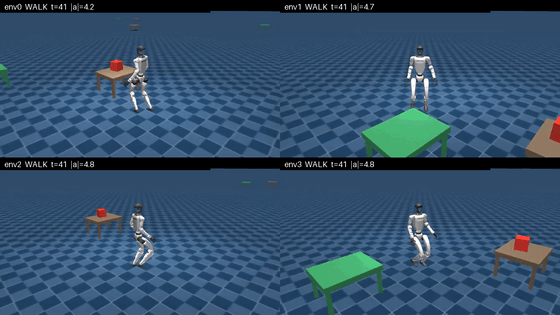

# unitree-g1-humanoid-monolithic-policy

> **Single-MLP loco-manipulation student for the Unitree G1: BC + DAgger fine-tune on an FSM-generated demonstration dataset.** One 115-D obs, one 29-D action, one phase one-hot. BC collapses the 4 expert policies into a single MLP; DAgger refits each round on BC seed + oracle-labelled student rollouts, where the oracle dispatches the 4 frozen experts by the current phase gate. Same distillation pattern as BeyondMimic (Liao et al., 2025), RL experts labelled by DAgger into a monolithic student, with an MLP student (vs. their latent-diffusion VAE) and MSE loss (vs. their ELBO).

[](LICENSE)
[](https://www.python.org/downloads/release/python-3100/)
[](https://github.com/google-deepmind/mujoco)
[](https://github.com/mujocolab/mjlab)
[](https://pytorch.org/)

<p align="center">
  
</p>
<p align="center"><sub>Grid of 4 BC-student rollouts under randomised spawn (annular distance 0.15 to 5.0 m, uniform angle, uniform initial yaw). <strong>GIF regenerated with <code>scripts/make_portfolio_media.py</code>.</strong></sub></p>


## What this does

- Trains a **single MLP** (115 D obs, 29 D action, 4-way phase one-hot) that reproduces the full walk to pick behaviour of the sibling experts.
- **FSM data generation** runs frozen experts in mjlab under **subprocess isolation per episode** (works around an mjlab context leak that would otherwise OOM around episode 60).
- **Phase-balanced BC**: `WeightedRandomSampler` evens out walk vs pick transition counts so the student does not collapse into a walking-only policy.
- **DAgger fine-tune** on top of BC: each round rolls out the current student in the WPCD env, labels every visited state with the FSM oracle (walk/pick/carry/drop experts dispatched by the phase gate), and refits by MSE on the BC seed plus the last `buffer_window` rounds of labels. Fixes the covariate shift that pure BC suffers from without the reward-engineering surface a PPO fine-tune would need.
- **Refit optimizations** always on: BC seed is pre-cached on the GPU across rounds (opt 1), and the input normaliser is frozen after round 0 (opt 4). Mixed precision (opt 2) and early stopping (opt 3) are opt-in behind flags: AMP wins on sm_80+ (A100 / H100 / B300) with bfloat16 but hurts on sm_75 (GTX 1650/1660) where fp16 has no tensor-core speedup for small matmuls; early stopping only pays off when the per-round loss plateaus before `epochs_per_round`.

## Results

Latest known metrics for the walk / pick / carry / drop pipeline. Reproduce by running `01_monolithic.ipynb` end-to-end; BC checkpoints land in `outputs/logs/g1_monolithic/` and DAgger checkpoints under `outputs/logs/g1_monolithic_dagger/`.

| Stage         | Metric                               | Value                       |
| ------------- | ------------------------------------ | --------------------------- |
| Dataset       | Episodes attempted                   | 5000                        |
| Dataset       | Episodes kept                        | **4512 (90.2%)**            |
| Dataset       | Raw pick success among kept episodes | **93.6%**                   |
| Dataset       | Pick-phase share of transitions      | 7.7%                        |
| BC            | Validation MSE minimum               | **0.0036** at iteration 394 |
| DAgger        | Rounds / epochs per round            | framework ready; see `outputs/logs/g1_monolithic_dagger` |

## Pipeline position

Downstream consumer of walk, pick (and optionally carry/place via the registry). Alternative to the FSM-only demo pipeline.

```
┌──────┐ ┌──────┐ ┌───────┐ ┌──────┐
│ walk │ │ pick │ │ carry │ │ drop │   (4 frozen RL experts)
└──┬───┘ └──┬───┘ └───┬───┘ └──┬───┘
   └────────┴─────────┴────────┘
                   │
                   ▼
       ┌──────────────────────┐
       │ FSM data gen (batched) │   src/fsm_wpcd_batched.py
       │ 4-phase chain, N envs │   (single process, mjlab warp)
       └──────────┬───────────┘
                  ▼
       outputs/walk_pick_carry_drop_batched.npz
                  │
                  ▼
       ┌──────────────────────┐
       │  BC (MSE, phase-     │   src/bc_train.py
       │  balanced sampler)   │
       └──────────┬───────────┘
                  ▼
                  │
        ┌─────────┴──────────┐
        │                    │
        ▼  (per round)       │ warm-start student
┌───────────────────┐        │
│ Rollout student   │        │
│ in WPCD env       │        │
└────────┬──────────┘        │
         ▼                   │
┌───────────────────┐        │
│ FSM oracle labels │        │
│ each state (opt   │        │
│ 1+4 always on)    │        │
└────────┬──────────┘        │
         ▼                   │
┌───────────────────┐        │
│ MSE refit on BC   │        │
│ seed + window N   │ ───────┘   src/dagger_finetune.py
└───────────────────┘
```

## Reproduce

### Quick smoke run (~2 min)

```bash
git clone https://github.com/narayanerm/unitree-g1-humanoid-monolithic-policy.git
cd unitree-g1-humanoid-monolithic-policy
uv pip install -r requirements.txt
bash scripts/stage_expert_checkpoints.sh
jupyter lab 01_monolithic.ipynb
```

Set `DEBUG_LIGHT = True` (8 envs × 3 BC epochs × 2 DAgger rounds, ~2 min end-to-end) and Run All.

### Full pipeline (B300-class GPU, ~30-90 min end-to-end)

```bash
# 1. FSM data generation (4-phase batched, single process, N envs in parallel)
python -m src.fsm_wpcd_batched \
    --num-envs 8192 --seed 100 --max-steps 1600 \
    --r-min 1.5 --r-max 5.0 \
    --out outputs/walk_pick_carry_drop_batched.npz

# 2. Phase-balanced BC
python -m src.bc_train \
    --dataset outputs/walk_pick_carry_drop_batched.npz \
    --epochs 6000 --batch-size 8192 --lr 6e-4

# 3. DAgger fine-tune (student rollout + FSM-oracle relabel + warm-started refit)
python -m src.dagger_finetune \
    --bc-ckpt outputs/logs/g1_monolithic/<timestamp>/model_best.pt \
    --bc-dataset outputs/walk_pick_carry_drop_batched.npz \
    --rounds 10 --num-envs 1024 --max-steps 400 \
    --epochs-per-round 60 --buffer-window 3
```

Notebook flags: `DEBUG_LIGHT`, `REUSE_DATASET`, `REUSE_BC`.

### Inspect

```bash
tensorboard --logdir_spec bc:outputs/logs/g1_monolithic,dagger:outputs/logs/g1_monolithic_dagger
```

BC curves land under `BC/*`; DAgger logs `Rollout/*` (phase fires, falls, transitions per round) and `DAgger/*` (train / val loss, epochs_run, best_val).

## Technology stack

| Component           | Choice                                                                                 |
| ------------------- | -------------------------------------------------------------------------------------- |
| Physics simulator   | MuJoCo Warp (GPU-parallel) via **mjlab**                                               |
| Experts             | Frozen rsl-rl actors from walk + pick + carry + drop                                   |
| Dataset generation  | FSM rollout, 1 env/subprocess (mjlab context-leak workaround)                          |
| Unified obs         | 115 D = 96 D proprioception + 15 D egocentric goal + 4 D phase one-hot                  |
| Student policy      | 3-layer MLP matching the sibling rsl-rl actor topology                                 |
| BC loss             | MSE, `WeightedRandomSampler` for walk / pick / carry / drop phase balance             |
| DAgger fine-tune    | Student rollout + oracle relabel (4 frozen experts dispatched by phase) + warm-started MSE refit |
| Compute target      | 1× NVIDIA B300 SXM6 (data gen); any CUDA GPU for BC + DAgger refit                     |

## Architecture highlights

- **Batched FSM data gen.** `src/fsm_wpcd_batched.py` runs all 4 experts (walk / pick / carry / drop) over N parallel envs in a single mjlab process, dispatched by physics-based phase gates. The earlier sequential path (`fsm_continuous_sequential.py`, one env per subprocess, used to work around an mjlab context leak at scale) is still in the repo for the walk+pick-only chain but is not the primary data source anymore.
- **Phase balance matters.** Walk produces an order of magnitude more transitions than pick. A plain BC run collapses to walk-only. `WeightedRandomSampler` on `phase_id` fixes this at train time without touching the dataset.
- **MLP topology mirrors the experts** so the DAgger refit stays warm-started from the BC checkpoint between rounds.
- **DAgger oracle in-process.** The 4 frozen experts are loaded as lightweight MLP wrappers over the shared pick env (no extra mjlab envs per expert) and dispatched by the phase gate at every student step. Walk and carry twists are direct pursuits (no A* re-planning) so the oracle is cheap enough to label every transition.
- **Expert registry is extensible.** [`src/expert_registry.py`](src/expert_registry.py) covers walk, pick, carry, place, reach. The DAgger oracle currently uses walk+pick+carry+drop; adding reach is a dict entry.

## Refit optimizations

The DAgger refit (opts 1-4 below) is tuned to be a no-regret default on sm_75 (GTX 1650/1660) while leaving the scale-up switches available for sm_80+ GPUs. Numbers from microbenchmark on a GTX 1650 with 60-epoch refit over 61k transitions:

| Variant | Wall | vs. baseline | Default |
| --- | ---: | ---: | --- |
| Baseline (no opts) | 4.60 s | 1.00x | n/a |
| **+ BC seed cache + freeze normaliser (opts 1 + 4)** | **3.56 s** | **1.29x** | **on** |
| + AMP (opt 2) alone | 13.38 s | 0.34x | off |
| + Early stop (opt 3) alone | 3.26 s | 1.41x | off |
| All 1-4 combined | 11.78 s | 0.39x | n/a |

**Always on:**

- **(1) `bc_seed_gpu_budget_bytes`**: BC seed `.npz` is loaded once and kept on the GPU for all rounds. Falls back to per-round disk reload if the seed exceeds the budget (default 2 GiB). On a 1.7 GB BC seed this saves ~10 s/round of disk I/O.
- **(4) `freeze_normalizer_after_round_zero`**: the input `RunningMeanStd` is fit on round 0 then frozen. Avoids drifting the input scale when the student distribution shifts across rounds.

**Opt-in (behind flags):**

- **(2) `use_amp`**: autocast fp16 (sm_75) / bfloat16 (sm_80+) + `GradScaler` on the refit. On sm_75 the GTX 1650 has no tensor-core path for the small 115/512/256/128/29 MLP and AMP adds 2-3x wall overhead with no speedup, so default is `False`. On A100 / H100 / B300 (sm_80+) bfloat16 should recover a 2-3x refit speedup; enable there.
- **(3) `early_stop_patience`**: val-split + per-epoch val forward, stops when val loss doesn't improve for N epochs. Default `0` (disabled). Only pays off when the refit is long enough that the stop can trigger before `epochs_per_round`; recommended for `epochs_per_round >= 60`.

**Not implemented, and why:**

- **CUDA graph capture over the rollout loop**: the oracle has data-dependent branches (`if in_pick.any(): ...`) that would force always-run-all-4-experts if captured, which is more expensive than the current skip-when-empty path.
- **Async refit in a separate process**: single-GPU setups cannot overlap, and the shared VRAM would just serialise jobs. Useful only with a second accelerator.

## Repo layout

```
src/
  fsm_wpcd_batched.py            4-phase batched FSM data gen (primary)
  fsm_continuous_sequential.py   Legacy sequential FSM (walk+pick only, subprocess per episode)
  bc_train.py                    Phase-balanced MSE behavioural cloning
  dagger_finetune.py             DAgger on top of BC, FSM-oracle relabel per round
  fsm_oracle in dagger_finetune  Four-expert dispatcher driven by the shared phase gate
  phase_gates.py                 Shared physics gates + per-env state for the chain
  student_policy.py              MonolithicPolicyStudent MLP
  goal_features.py               Unified 115-D observation layout
  policy_walk.py, policy_pick.py Expert wrappers used by the FSM
  expert_registry.py             Resolves expert checkpoints staged in experts/
experts/                         Staged expert checkpoints (populated by scripts/)
outputs/                         Datasets, logs, TensorBoard runs
```

## Visual assets

```bash
python scripts/make_portfolio_media.py outputs/media/wpcd_n4_grid_latest.mp4
# writes docs/demo.gif + docs/frame_map.png
```

## Chain

| Repo | Role |
| --- | --- |
| [walk](../unitree-g1-humanoid-walk) | Expert 1 (used by FSM) |
| [reach](../unitree-g1-humanoid-reach) | Available in registry, not exercised yet |
| [pick](../unitree-g1-humanoid-pick) | Expert 2 (used by FSM) |
| [carry](../unitree-g1-humanoid-carry) | Available in registry, not exercised yet |
| [place](../unitree-g1-humanoid-place) | Available in registry, not exercised yet |
| [fsm](../unitree-g1-humanoid-fsm) | Alternative FSM-only pipeline (same obs schema) |
| **[monolithic-policy](.)** (you are here) | BC + DAgger student on FSM-generated data |

## Citation

```bibtex
@misc{medeiros2026g1mono,
  author       = {Ribeiro Medeiros, Narayane},
  title        = {unitree-g1-humanoid-monolithic-policy: single-policy loco-manipulation student for the Unitree G1},
  year         = {2026},
  howpublished = {\url{https://github.com/narayanerm/unitree-g1-humanoid-monolithic-policy}}
}
```

Distillation references:

```bibtex
@inproceedings{ross2011dagger,
  author    = {Ross, Stephane and Gordon, Geoffrey J. and Bagnell, J. Andrew},
  title     = {A Reduction of Imitation Learning and Structured Prediction to No-Regret Online Learning},
  booktitle = {AISTATS},
  year      = {2011}
}

@article{liao2025beyondmimic,
  author  = {Liao, Qiayuan and Truong, Takara E. and Huang, Xiaoyu and Tevet, Guy and Sreenath, Koushil and Liu, C. Karen},
  title   = {{BeyondMimic}: From Motion Tracking to Versatile Humanoid Control via Guided Diffusion},
  journal = {arXiv:2508.08241},
  year    = {2025}
}
```

BeyondMimic uses the same RL-experts to DAgger-distill pattern this repo follows, with a latent state-action diffusion student (vs. our MLP) and classifier guidance at inference (not used here).

## Author

**Narayane Ribeiro Medeiros**, ITAndroids Humanoid Team, Instituto Tecnológico de Aeronáutica.
[GitHub](https://github.com/narayanerm) · [LinkedIn](https://www.linkedin.com/in/narayanerm) · narayane.rm@gmail.com

Released under the [MIT License](LICENSE).
